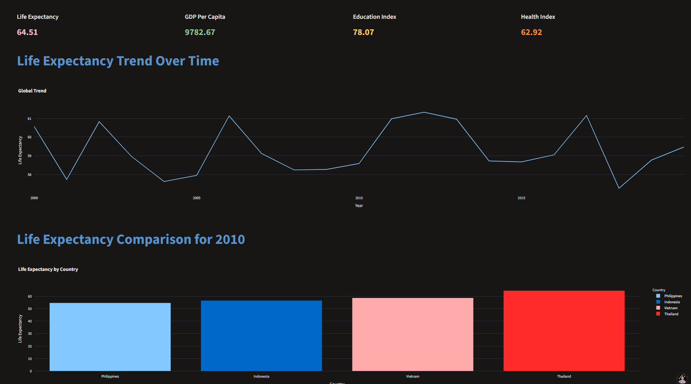

# ❤️ Drivers of Life Expectancy Dashboard

> *An interactive Streamlit dashboard analyzing the impact of GDP, education, and health indices on global life expectancy using Plotly visualizations.*

[](https://life-expectancy-dashboard-8jivbqhmm8b4gp9vceyffh.streamlit.app/)
*Click the image above to open the live interactive dashboard.*

## 📌 Executive Summary
The **Drivers of Life Expectancy Dashboard** is an analytical tool built to explore Sustainable Development Goals (SDG) metrics. This application investigates the macroeconomic and social factors that influence human longevity. By leveraging interactive scatter plots, trendlines, and multi-variable bubble charts, the dashboard provides clear visual evidence of how GDP per capita, education levels, and health indices correlate with life expectancy across different nations and timeframes.

---

## 🚀 Live Demo
Access the deployed application here: **[Drivers of Life Expectancy Dashboard](https://nuggets0503-kyryobumadotmmetnqpwxw.streamlit.app/)**

---

## ✨ Key Features
* **Dynamic Time Filtering:** Users can scrub through historical data via an intuitive slider to see how global metrics shift year over year.
* **Granular KPI Scorecards:** Dynamically calculates both global averages and country-specific metrics for Life Expectancy, GDP, Education, and Health based on the selected year.
* **Trend Analysis:** Features a time-series line chart tracking the global average life expectancy trajectory.
* **Cross-Sectional Comparison:** Utilizes interactive bar charts to compare life expectancy side-by-side across nations.
* **Exploratory Correlation:** Includes an Ordinary Least Squares (OLS) trendline scatter plot and a multi-variable bubble chart (sized by Education Index) to visually test the relationships between GDP and lifespan.

---

## 💡 Recommendation
Prioritize direct investments in health and education over general economic growth, as social infrastructure yields faster, more predictable life expectancy gains than wait for GDP to rise.

---

## 🛠️ Tech Stack
This project is built using the following Python ecosystem:
* **[Streamlit](https://streamlit.io/):** For rapid web application deployment and UI construction.
* **[Plotly Express](https://plotly.com/python/plotly-express/):** For creating highly interactive, publication-quality graphs and charts.
* **[Pandas](https://pandas.pydata.org/) & [NumPy](https://numpy.org/):** For data ingestion, aggregation, and mathematical operations.
* **[Pillow (PIL)](https://pillow.readthedocs.io/):** For image processing and banner integration.

---

## 💻 Local Installation & Usage
```bash
git clone https://github.com/EJTeope/Life-Expectancy-Dashboard.git
cd Life-Expectancy-Dashboard
pip install -r requirements.txt
streamlit run app.py
```
